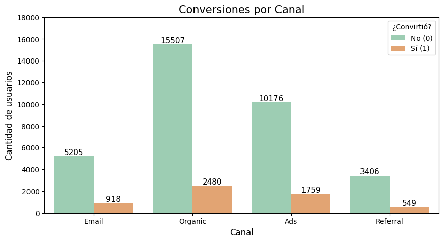

# Experimento A/B en una página de inicio

Evaluación de un experimento A/B sobre 40.000 usuarios expuestos a dos versiones de una landing page durante cuatro semanas (1 al 28 de enero de 2026). El objetivo es recomendar qué versión usar, con pruebas estadísticas que respalden la decisión.

**Resultado principal:** la página B gana por dos vías. Convierte más usuarios (15,96 % frente a 12,57 %) y quienes compran desde ella gastan más (68,75 frente a 61,09). Ambas diferencias son estadísticamente significativas.

[Ver el notebook](analisis_experimento_ab.ipynb) · [Abrir en Google Colab](https://colab.research.google.com/github/fvt1999pipe-eng/analisis_experimento_ab/blob/main/analisis_experimento_ab.ipynb)

## Preguntas de negocio

1. ¿Qué versión de la página genera mayor conversión y mayor gasto promedio?
2. ¿Qué canales de tráfico son más efectivos para generar conversiones?
3. ¿Existen diferencias en la conversión según el tipo de usuario?

## Resultados

| Pregunta | Prueba | Resultado | Lectura para el negocio |
|---|---|---|---|
| Gasto promedio de los usuarios que convirtieron, A frente a B | t de Welch (Levene indicó varianzas distintas) | B: 68,75 · A: 61,09 (+12,5 %). t = −9,48; p < 0,001 | Quien compra en la página B gasta más por compra. |
| Tasa de conversión, A frente a B | Z de dos proporciones | B: 15,96 % · A: 12,57 % (+3,38 puntos). Z = −9,68; p < 0,001 | B convierte cerca de 27 % más: unas 680 conversiones adicionales por cada 20.000 usuarios. |
| Fuente de tráfico y conversión | Chi-cuadrado de independencia | Asociación significativa pero pequeña (χ² = 8,66; p = 0,034). Tasas entre 13,8 % (Organic) y 15,0 % (Email) | Los canales difieren poco en efectividad; las conversiones de cada canal dependen sobre todo de su volumen. |
| Tipo de usuario y conversión | Chi-cuadrado de independencia | Sin asociación (χ² = 0,51; p = 0,474). Nuevos: 14,36 % · recurrentes: 14,09 % | No hace falta diferenciar la página por tipo de usuario. |



*Conversiones por canal. Organic aporta el 43,5 % de las conversiones (2.480) aunque tiene la tasa más baja: el volumen de tráfico pesa más que la diferencia entre tasas.*

### Recomendaciones

1. **Página:** priorizar la versión B, que supera a la A en conversión y en gasto. Antes de implementarla, cuantificar el impacto en ingresos y confirmar que no hubo factores externos durante el experimento, como promociones o festividades.
2. **Canales:** mantener Organic como base de volumen y evaluar si conviene aumentar el tráfico de Email y Ads, que convierten un poco mejor. La decisión requiere el costo por canal, que no está en el dataset.
3. **Tipo de usuario:** usar la misma página para usuarios nuevos y recurrentes, porque convierten de forma similar.

### Limitaciones

- El periodo observado es de cuatro semanas; los resultados pueden no representar otros momentos del año.
- La significancia estadística no prueba que el diseño de la página sea la única causa de la diferencia ni que esta justifique el cambio por sí sola.
- La prueba chi-cuadrado indica que hay asociación entre canal y conversión, pero no entre qué canales está la diferencia.

## Datos

| Archivo | Filas | Contenido |
|---|---|---|
| `landing_experiment.csv` | 40.000 | Un registro por usuario con 9 columnas: versión de la página (A o B), fecha de exposición, región, dispositivo, fuente de tráfico, tipo de usuario, conversión y gasto. |

Los datos son un caso de estudio del bootcamp de Análisis de Datos de TripleTen y no se incluyen en el repositorio.

## Metodología

1. **Validación de los datos:** estructura, valores ausentes, usuarios únicos, rango de fechas, coherencia entre conversión y gasto, y balance entre grupos (19.982 usuarios en A y 20.018 en B).
2. **Gasto promedio:** prueba de Levene para comparar varianzas y prueba t de Welch sobre los 5.706 usuarios que convirtieron.
3. **Tasa de conversión:** prueba Z de dos proporciones sobre los 40.000 usuarios.
4. **Variables categóricas:** pruebas chi-cuadrado de independencia para la fuente de tráfico y para el tipo de usuario.
5. **Visualización:** conteos y proporciones de conversión por canal y por tipo de usuario.
6. **Conclusiones:** resumen ejecutivo, recomendaciones y limitaciones.

Todas las pruebas usan un nivel de significancia de 0,05.

## Estructura del repositorio

```
analisis_experimento_ab/
├── analisis_experimento_ab.ipynb   Notebook con el análisis completo
├── img/                            Gráficos del análisis
├── requirements.txt                Librerías necesarias
└── README.md
```

## Cómo reproducir el análisis

1. Clona el repositorio e instala las librerías:

   ```bash
   git clone https://github.com/fvt1999pipe-eng/analisis_experimento_ab.git
   cd analisis_experimento_ab
   pip install -r requirements.txt
   ```

2. Crea una carpeta `datasets/` junto al notebook y copia en ella el archivo `landing_experiment.csv`.
3. Abre `analisis_experimento_ab.ipynb` en Jupyter y ejecuta las celdas en orden.

## Herramientas

Python · pandas · SciPy · statsmodels · Matplotlib · Seaborn · Jupyter

## Autor

**Felipe Vásquez Torres**, analista de datos con experiencia en supply chain y operaciones.

[LinkedIn](https://www.linkedin.com/in/felipe-vasquez-torres) · [Portafolio](https://fvt1999pipe-eng.github.io) · fe.vasqueztorres@gmail.com
